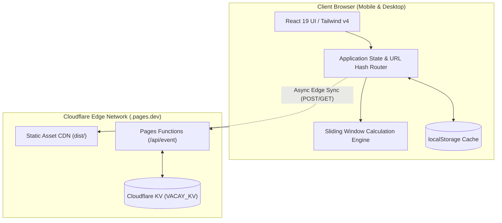
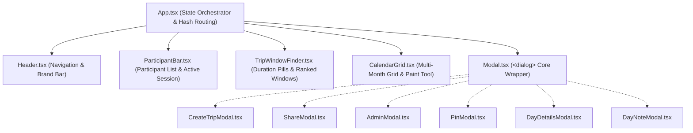
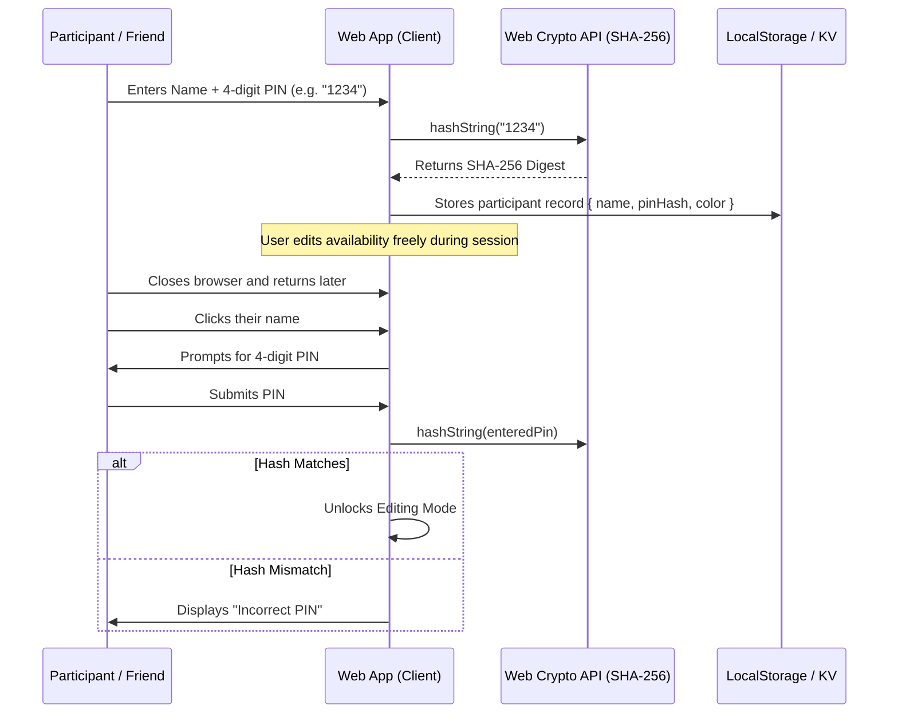

# VacayFree — Technical Architecture & Engineering Specification

## 1. Executive Summary & System Overview

**VacayFree** is a high-performance, mobile-first web application designed to eliminate coordination friction when groups of friends plan vacations. Unlike generic meeting schedulers (e.g., When2meet, LettuceMeet, Doodle) that focus on hourly time slots or require cumbersome account registrations, VacayFree operates on **full calendar days across multi-week/month horizons** and features an automated **Sliding Window Finder** that computes and ranks continuous trip spans (e.g., weekend, 1-week, 2-week, or custom duration) by group availability.

### 1.1 Architecture Topology

The application follows a **Local-First, Edge-Enhanced Serverless Architecture**:



- **Static Delivery**: Hosted on Cloudflare Pages global edge network.
- **Client Runtime**: Zero backend requirement for core features. All computations (date math, heatmaps, sliding window rankings, PIN verification) run client-side in sub-millisecond execution.
- **Edge Persistence**: Cloudflare Pages Functions (`/api/event.ts`) backed by Cloudflare KV provide optional cross-device synchronization without hosting dedicated database servers.

---

## 2. Technology Stack & Dependencies

| Layer | Technology | Version | Purpose |
|---|---|---|---|
| **Runtime / Build** | Vite | `^6.2.0` | Ultra-fast HMR and ESM bundler producing optimized production chunks. |
| **Language** | TypeScript | `~5.7.3` | Strict type safety across domain models and algorithm pipelines. |
| **UI Framework** | React | `^19.0.0` | Modern React 19 functional components and declarative state hooks. |
| **Styling** | Tailwind CSS v4 | `^4.0.9` | Zero-runtime CSS engine with `@tailwindcss/vite` integration. |
| **Icons** | Lucide React | `^1.16.0` | Consistent, accessible stroke icons. |
| **Date Processing** | date-fns | `^4.1.0` | Modular, immutable date manipulation (`eachDayOfInterval`, `parseISO`, `format`). |
| **Visual FX** | canvas-confetti | `^1.9.4` | Micro-interaction celebration burst when winning dates are chosen. |
| **Edge Deployment** | Cloudflare Pages & Wrangler | `^4.152.0` | Zero-configuration static hosting and serverless Pages Functions. |

---

## 3. Domain Models & Type System

All core schemas are strictly defined in [`src/types/index.ts`](file:///Users/hugues/Code/free-time-finder/src/types/index.ts):

```typescript
export type AvailabilityStatus = 'available' | 'maybe' | 'busy';

export interface DayAvailability {
  date: string; // ISO format "YYYY-MM-DD"
  status: AvailabilityStatus;
  note?: string; // Optional context (e.g. "Arriving in evening")
}

export interface Participant {
  id: string; // e.g. "p-x8k2lm"
  eventId: string;
  name: string;
  pinHash: string; // SHA-256 hash of participant's 4-digit PIN
  color: string;   // Tailwind color class for avatar badge
  createdAt: string; // ISO 8601
}

export interface ParticipantResponse {
  participantId: string;
  eventId: string;
  availability: Record<string, DayAvailability>; // Map of "YYYY-MM-DD" -> DayAvailability
  updatedAt: string;
}

export interface TripEvent {
  id: string; // Unique event slug (e.g. "trip-8f3a92")
  title: string;
  description?: string;
  destinationHint?: string;
  startDate: string; // "YYYY-MM-DD"
  endDate: string;   // "YYYY-MM-DD"
  defaultDurationDays: number; // e.g. 7
  adminKeyHash: string; // SHA-256 hash of organizer secret key
  isLocked: boolean; // When true, prevents edits to availability
  createdAt: string;
  updatedAt: string;
}

export interface DaySummary {
  date: string;
  availableCount: number;
  maybeCount: number;
  busyCount: number;
  totalParticipants: number;
  score: number; // Normalized [0.0, 1.0]
  percentage: number; // [0, 100]
  notes: Array<{
    participantId: string;
    participantName: string;
    note: string;
    status: AvailabilityStatus;
  }>;
  participants: Array<{
    participantId: string;
    participantName: string;
    color: string;
    status: AvailabilityStatus;
    note?: string;
  }>;
}

export interface TripWindow {
  startDate: string;
  endDate: string;
  durationDays: number;
  averageScore: number;
  minAvailable: number; // Bottleneck day availability in window
  fullAttendance: boolean; // True only if 100% of participants are 'available' every day
  attendancePercentage: number;
  daySummaries: DaySummary[];
  unvailableParticipants: Array<{
    id: string;
    name: string;
    daysUnavailable: number;
  }>;
}
```

---

## 4. Core Algorithms

### 4.1 Day Summary & Attendance Scoring

For any given day $d \in [\text{startDate}, \text{endDate}]$ and a set of participants $P$ with total count $N = |P|$:

$$\text{score}(d) = \begin{cases} 
\frac{1.0 \times \text{count}(\text{available}) + 0.5 \times \text{count}(\text{maybe})}{N} & \text{if } N > 0 \\
0 & \text{if } N = 0
\end{cases}$$

$$\text{percentage}(d) = \text{round}(\text{score}(d) \times 100)$$

- **Available** contributes full weight ($1.0$).
- **Maybe / If Needed** contributes half weight ($0.5$), enabling flexible friends to boost options.
- **Busy** contributes zero weight ($0.0$).

### 4.2 Sliding Window Best Date Algorithm

Located in [`src/utils/dateCalc.ts`](file:///Users/hugues/Code/free-time-finder/src/utils/dateCalc.ts#L104-L188):

Given an event date interval of length $T$ days and a target vacation duration $D$ days:

1. **Window Enumeration**: Generate continuous sub-intervals $W_i = [d_i, d_{i + D - 1}]$ for $i = 0, 1, \dots, T - D$.
2. **Metrics Computation per Window**:
   - **Average Score**: $\bar{S}(W_i) = \frac{1}{D} \sum_{k=0}^{D-1} \text{score}(d_{i+k})$.
   - **Bottleneck Capacity**: $\min_{k=0}^{D-1} \text{count}(\text{available}, d_{i+k})$.
   - **Full Attendance Check**: A participant $p$ is strictly available for window $W_i$ iff:
     $$\forall k \in [0, D-1], \quad \text{status}(p, d_{i+k}) = \text{'available'}$$
     If and only if all $N$ participants satisfy this condition, `fullAttendance = true`.
   - **Unavailable Breakdown**: For participants who have busy or maybe days in window $W_i$, count the exact number of compromised days.
3. **Multi-Factor Lexicographical Sorting**:
   Windows are prioritized using the following ordering rules:
   1. `fullAttendance` descending (`true` before `false`).
   2. `averageScore` descending.
   3. `minAvailable` bottleneck descending.
   4. `startDate` ascending (chronological tie-breaker).

---

## 5. UI Architecture & Component Hierarchy



### 5.1 Component Breakdown

1. **[`App.tsx`](file:///Users/hugues/Code/free-time-finder/src/App.tsx)**:
   - Manages global state (`eventData`, `currentParticipant`, `isAdmin`, `targetDuration`, `selectedWindow`).
   - Implements URL hash synchronization (`#event=<id>&admin=<key>`).
   - Provides clean transitions between Landing Hero and Active Poll view.
2. **[`CalendarGrid.tsx`](file:///Users/hugues/Code/free-time-finder/src/components/CalendarGrid.tsx)**:
   - **Heatmap View**: Renders date cells colored by attendance percentage with available badges.
   - **Paint Mode**: Activated when a user is selected. Enables mouse pointer / touch drag painting across date cells with brush modes (`Available`, `Maybe`, `Busy`).
   - Supports day notes and window highlight frames.
3. **[`TripWindowFinder.tsx`](file:///Users/hugues/Code/free-time-finder/src/components/TripWindowFinder.tsx)**:
   - Duration selector pills (`Weekend (3d)`, `1 Week (7d)`, `2 Weeks (14d)`, `Custom` with stepper).
   - Displays ranked cards with medals (🥇, 🥈, 🥉), attendance match percentage, missing participant badges, and "Highlight on Calendar" trigger.
4. **[`Modal.tsx`](file:///Users/hugues/Code/free-time-finder/src/components/ui/Modal.tsx)**:
   - Implements the HTML5 `<dialog>` specification with `closedby="any"` and `showModal()`.
   - Incorporates bounding-box backdrop click detection as a fallback for Safari.
   - Constrained to explicit widths (`max-w-sm: 384px`, `max-w-md: 480px`, `max-w-lg: 560px`) with solid white backgrounds to eliminate viewport overflow.

---

## 6. Security & Access Model

The security model is engineered around **maximum social convenience with collision prevention**:



### 6.1 Cryptographic Hash Verification
- Standard SHA-256 hashing is implemented via native `window.crypto.subtle.digest`:
  ```typescript
  export async function hashString(input: string): Promise<string> {
    const msgUint8 = new TextEncoder().encode(input.trim());
    const hashBuffer = await crypto.subtle.digest('SHA-256', msgUint8);
    const hashArray = Array.from(new Uint8Array(hashBuffer));
    return hashArray.map(b => b.toString(16).padStart(2, '0')).join('');
  }
  ```
- **Organizer Admin Key**: A 16-character pseudo-random token (`generateAdminKey()`) is generated on creation. The hash is saved with the event; the raw key is stored in the creator's local storage or provided in the secret link (`#event=...&admin=...`).
- **Participant PIN**: A 4-digit numeric string chosen by the participant. Only the hash is stored, preventing casual snooping or accidental overwrite while avoiding email verification loops.

---

## 7. Storage & Cloud Synchronization

VacayFree employs a **dual-layer storage adapter** in [`src/services/storage.ts`](file:///Users/hugues/Code/free-time-finder/src/services/storage.ts):

1. **Synchronous Local Persistence (`localStorage`)**:
   - Keys: `vacayfree_event_<id>`, `vacayfree_admin_<id>`, `vacayfree_session_<id>`, `vacayfree_recent_events`.
   - Guarantees immediate zero-latency UI updates and offline resilience.
2. **Asynchronous Edge Sync (`/api/event`)**:
   - Cloudflare Pages Functions (`functions/api/event.ts`) intercept `GET /api/event?id=...` and `POST /api/event`.
   - When a Cloudflare KV namespace binding (`VACAY_KV`) is attached, mutations are stored globally across Cloudflare's edge data centers with a 90-day retention TTL (`expirationTtl: 7776000`).

---

## 8. Deployment & Build Specifications

### 8.1 Production Build Pipeline
- Bundle command: `npm run build` (`tsc -b && vite build`)
- Target: `ES2022`
- Output Directory: `dist/`
- Production Artifacts:
  - `dist/index.html` (~1.04 kB)
  - `dist/assets/index-*.css` (~39.7 kB)
  - `dist/assets/index-*.js` (~351 kB)

### 8.2 Cloudflare Pages Configuration
- **Platform**: Cloudflare Pages (`.pages.dev`)
- **Framework Preset**: `Vite`
- **Build Command**: `npm run build`
- **Output Directory**: `dist`
- **Functions Routing**: Native support via `/functions` directory.
- **Wrangler Configuration** ([`wrangler.toml`](file:///Users/hugues/Code/free-time-finder/wrangler.toml)):
  ```toml
  name = "vacayfree"
  compatibility_date = "2026-01-01"
  pages_build_output_dir = "./dist"
  ```
