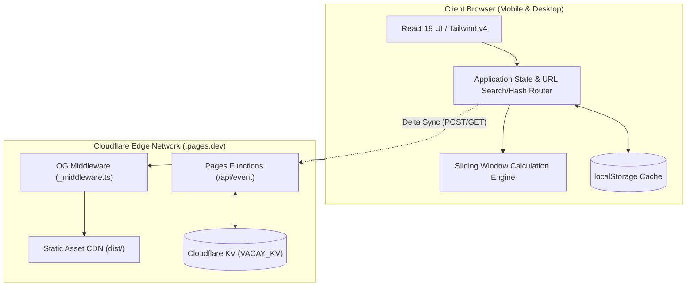
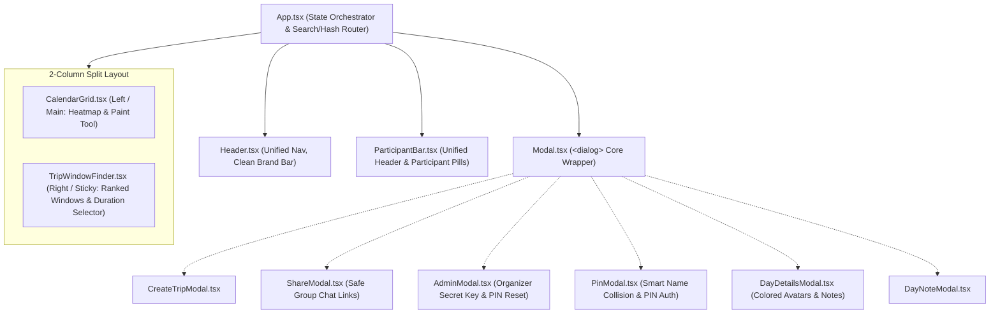

# VacayFree — Technical Architecture & Engineering Specification

## 1. Executive Summary & System Overview

**VacayFree** is a high-performance, mobile-first web application designed to eliminate coordination friction when groups of friends plan vacations. Unlike generic meeting schedulers (e.g., When2meet, LettuceMeet, Doodle) that focus on hourly time slots or require cumbersome account registrations, VacayFree operates on **full calendar days across multi-week/month horizons** and features an automated **Sliding Window Finder** that computes and ranks continuous trip spans (e.g., weekend, 1-week, 2-week, or custom duration) by group availability.

### 1.1 Architecture Topology

The application follows a **Local-First, Edge-Enhanced Serverless Architecture**:



- **Static Delivery**: Hosted on Cloudflare Pages global edge network with dynamic OpenGraph meta injection.
- **Client Runtime**: Zero backend requirement for core features. All computations (date math, heatmaps, sliding window rankings, PIN verification) run client-side in sub-millisecond execution.
- **Edge Persistence**: Cloudflare Pages Functions (`/api/event.ts`) backed by Cloudflare KV provide cross-device synchronization with discrete per-participant keys to eliminate concurrent write collisions.

---

## 2. Technology Stack & Dependencies

| Layer | Technology | Version | Purpose |
|---|---|---|---|
| **Runtime / Build** | Vite | `^6.2.0` | Ultra-fast HMR and ESM bundler producing optimized production chunks. |
| **Language** | TypeScript | `~5.7.3` | Strict type safety across domain models and algorithm pipelines. |
| **UI Framework** | React | `^19.0.0` | Modern React 19 functional components and declarative state hooks. |
| **Styling** | Tailwind CSS v4 | `^4.0.9` | Zero-runtime CSS engine with `@tailwindcss/vite` integration. |
| **Icons** | Lucide React | `^1.16.0` | Consistent, accessible stroke icons. |
| **Date Processing** | date-fns | `^4.1.0` | Modular, immutable date manipulation (`eachDayOfInterval`, `parseISO`, `format`). |
| **Visual FX** | canvas-confetti | `^1.9.4` | Micro-interaction celebration burst when winning dates are chosen. |
| **Edge Deployment** | Cloudflare Pages & Wrangler | `^4.152.0` | Zero-configuration static hosting and serverless Pages Functions. |

---

## 3. Domain Models & Type System

All core schemas are strictly defined in [`src/types/index.ts`](file:///Users/hugues/Code/free-time-finder/src/types/index.ts):

```typescript
export type AvailabilityStatus = 'available' | 'maybe' | 'busy';

export interface DayAvailability {
  date: string; // ISO format "YYYY-MM-DD"
  status: AvailabilityStatus;
  note?: string; // Optional context (e.g. "Arriving in evening")
}

export interface Participant {
  id: string; // e.g. "p-x8k2lm"
  eventId: string;
  name: string;
  pinHash: string; // Salted SHA-256 hash of participant's 4-digit PIN
  color: string;   // Tailwind color class for avatar badge
  createdAt: string; // ISO 8601
}

export interface ParticipantResponse {
  participantId: string;
  eventId: string;
  availability: Record<string, DayAvailability>; // Map of "YYYY-MM-DD" -> DayAvailability
  updatedAt: string;
}

export interface TripEvent {
  id: string; // Unique event slug (e.g. "trip-8f3a92")
  title: string;
  description?: string;
  destinationHint?: string;
  startDate: string; // "YYYY-MM-DD"
  endDate: string;   // "YYYY-MM-DD"
  defaultDurationDays: number; // e.g. 7
  adminKeyHash: string; // Salted SHA-256 hash of organizer secret key
  isLocked: boolean; // When true, prevents edits to availability
  createdAt: string;
  updatedAt: string;
}

export interface DaySummary {
  date: string;
  availableCount: number;
  maybeCount: number;
  busyCount: number;
  totalParticipants: number;
  score: number; // Normalized [0.0, 1.0]
  percentage: number; // [0, 100]
  notes: Array<{
    participantId: string;
    participantName: string;
    note: string;
    status: AvailabilityStatus;
  }>;
  participants: Array<{
    participantId: string;
    participantName: string;
    color: string;
    status: AvailabilityStatus;
    note?: string;
  }>;
}

export interface TripWindow {
  startDate: string;
  endDate: string;
  durationDays: number;
  averageScore: number;
  minAvailable: number; // Bottleneck day availability in window
  fullAttendance: boolean; // True only if 100% of participants are 'available' every day
  attendancePercentage: number;
  daySummaries: DaySummary[];
  unavailableParticipants: Array<{
    id: string;
    name: string;
    daysUnavailable: number;
  }>;
  maybeParticipants?: Array<{
    id: string;
    name: string;
    daysMaybe: number;
  }>;
}
```

---

## 4. Core Algorithms

### 4.1 Day Summary & Attendance Scoring

For any given day $d \in [\text{startDate}, \text{endDate}]$ and a set of participants $P$ with total count $N = |P|$:

$$\text{score}(d) = \begin{cases} 
\frac{1.0 \times \text{count}(\text{available}) + 0.5 \times \text{count}(\text{maybe})}{N} & \text{if } N > 0 \\
0 & \text{if } N = 0
\end{cases}$$

$$\text{percentage}(d) = \text{round}(\text{score}(d) \times 100)$$

- **Available** contributes full weight ($1.0$).
- **Maybe / If Needed** contributes half weight ($0.5$), enabling flexible friends to boost options.
- **Busy** contributes zero weight ($0.0$).

### 4.2 Sliding Window Best Date Algorithm

Located in [`src/utils/dateCalc.ts`](file:///Users/hugues/Code/free-time-finder/src/utils/dateCalc.ts#L104-L188):

Given an event date interval of length $T$ days and a target vacation duration $D$ days:

1. **Window Enumeration**: Generate continuous sub-intervals $W_i = [d_i, d_{i + D - 1}]$ for $i = 0, 1, \dots, T - D$.
2. **Metrics Computation per Window**:
   - **Average Score**: $\bar{S}(W_i) = \frac{1}{D} \sum_{k=0}^{D-1} \text{score}(d_{i+k})$.
   - **Bottleneck Capacity**: $\min_{k=0}^{D-1} \text{count}(\text{available}, d_{i+k})$.
   - **Full Attendance Check**: A participant $p$ is strictly available for window $W_i$ iff:
     $$\forall k \in [0, D-1], \quad \text{status}(p, d_{i+k}) = \text{'available'}$$
     If and only if all $N$ participants satisfy this condition, `fullAttendance = true`.
   - **Distinct Unavailable vs. Maybe Breakdown**:
     - `unavailableParticipants`: Friends with busy days in $W_i$.
     - `maybeParticipants`: Friends with maybe days in $W_i$.
3. **Multi-Factor Lexicographical Sorting**:
   Windows are prioritized using the following ordering rules:
   1. `fullAttendance` descending (`true` before `false`).
   2. `averageScore` descending.
   3. `minAvailable` bottleneck descending.
   4. `startDate` ascending (chronological tie-breaker).

---

## 5. UI Architecture & 2-Column Desktop Layout



---

## 6. Security & Concurrency Architecture

### 6.1 Salted Cryptographic Hashing (Anti-Rainbow Table)
To prevent 4-digit PIN brute-force attacks across the 10,000-value space (`0000`–`9999`):
```typescript
const SALT_PEPPER = 'vacay_salt_sec_2026';

export async function hashParticipantPin(eventId: string, participantId: string, pin: string): Promise<string> {
  return hashString(`${eventId}:${participantId}:${pin.trim()}:${SALT_PEPPER}`);
}

export async function hashAdminKey(eventId: string, adminKey: string): Promise<string> {
  return hashString(`${eventId}:${adminKey.trim()}:${SALT_PEPPER}`);
}
```
Every PIN hash is cryptographically bound to its unique `eventId`, `participantId`, and internal pepper, completely defeating generic precomputed hash tables.

### 6.2 Public API Hash Sanitization
When clients or crawlers request `GET /api/event?id=...`, the Cloudflare Pages Function automatically strips all internal hashes before serving the response:
- `event.adminKeyHash` $\rightarrow$ `""`
- `participant.pinHash` $\rightarrow$ `""`

Network tab inspection reveals **zero password or PIN hashes**.

### 6.3 Concurrency & Race-Condition Prevention (Discrete KV Deltas)
To solve "last-write-wins" collisions when multiple friends save availability concurrently from a group chat:
- Client availability updates are submitted as discrete deltas via `POST /api/event` with `action: 'save_response'`.
- Storage is partitioned into independent Cloudflare KV keys:
  - `event:${eventId}:meta` (Event bounds & lock status)
  - `event:${eventId}:participants` (Participant metadata index)
  - `event:${eventId}:response:${participantId}` (Discrete response per participant)
- When Friend #5 and Friend #1 hit save at the exact same second, their writes target separate KV keys (`response:p1` vs `response:p5`). Neither can overwrite the other.

---

## 7. Timezone Safety

All calendar operations strictly use `date-fns` `parseISO` and `eachDayOfInterval` instead of native `new Date("YYYY-MM-DD")`, preventing UTC midnight timezone rollback bugs in western hemispheres.
